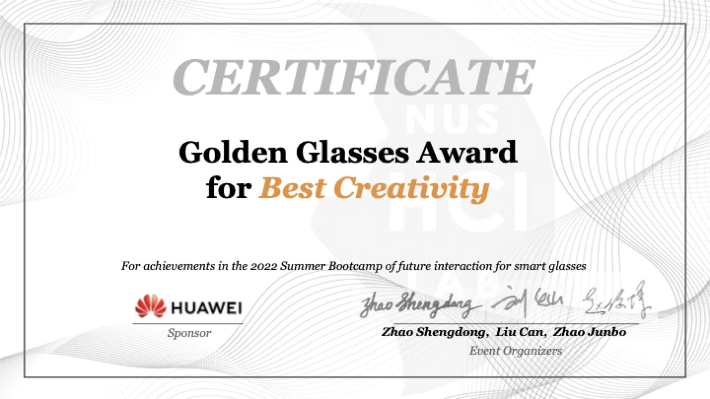

# Group3: EyePay

## 🏆 Award
**Golden Glasses Award for Best Creativity** at the 2022 Summer Bootcamp of Future Interaction for Smart Glasses (NUS-HCI Lab, sponsored by Huawei), 23–28 May 2022.

Certificate: [PDF](<Award/Golden Glasses Award - Best Creativity.pdf>) · [Bootcamp awards page](https://sites.google.com/comp.nus.edu.sg/bootcamp/awards)

## Project Description (max 3 lines)
- Seamless payment procedure
- Effortless login to e-commerce platform
- Paves the way for an interactive future

## Quick Start Guide (how to run the codes for Vuzix Blade)
- Download latest Unity game engine
- Download and import vuforia 8.6.0 as a local package from https://dev.azure.com/vuforia-engine/unity-extension/_git/com.ptc.vuforia.engine?version=GB8.6
- Ensure minimum API level is 22 at most
- Build and Run!

## Engineering Complexity (effort/what you did)
- Interfaced with the vuforia library to spawn objects on top of real world images
- Created 3D assets
- Interfaced with gestures and camera of glasses

## References (if any)
- Vuzix Blade Developer guide 
- Vuforia C# Library for Unity
- 30LSVP: Towards Effective On-the-go Video Learning Using OpticalHead-Mounted DisplaysASHWIN RAM and SHENGDONG ZHAO,NUS-HCI Lab, Department of Computer Science, NationalUniversity of Singapore, Singapore
- Gannouni, S., Aledaily, A., Belwafi, K. et al. Emotion detection using electroencephalography signals and a zero-time windowing-based epoch estimation and relevant electrode identification. Sci Rep 11, 7071 (2021). https://doi.org/10.1038/s41598-021-86345-5

